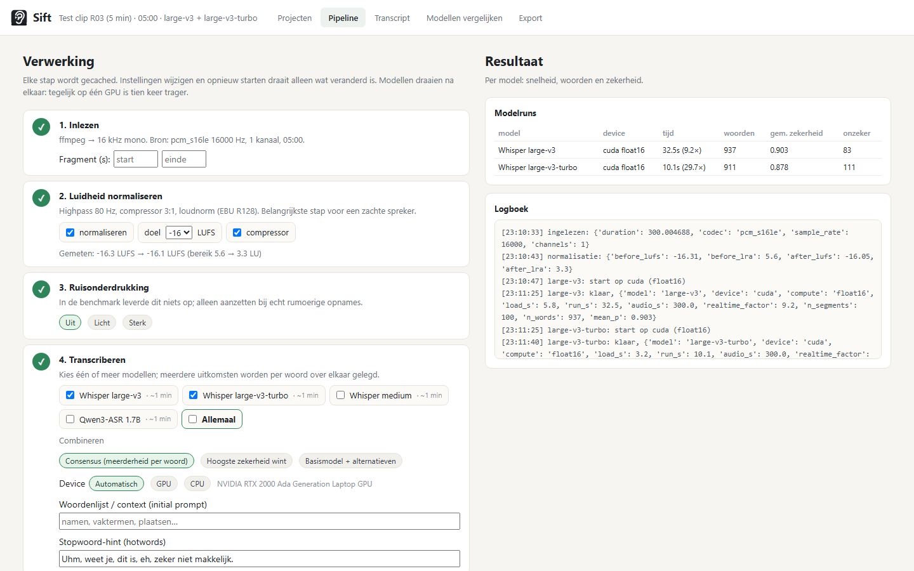
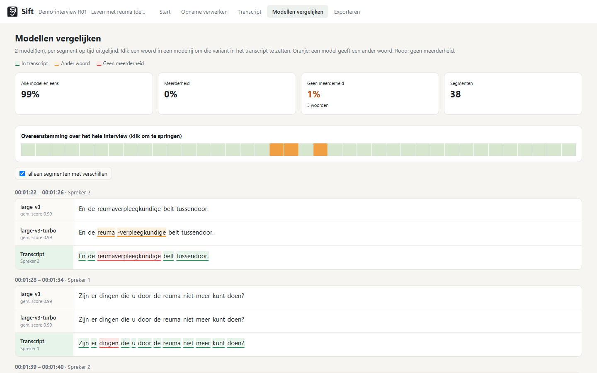

<p align="center"></p>

# Sift

**Lokale interviewtranscriptie die laat zien waar je moet luisteren.**

Sift transcribeert interviews volledig op je eigen computer (CPU of NVIDIA-GPU), legt meerdere spraakmodellen over elkaar en toont per woord hoe zeker het model is. In de editor klik je op een woord, hoort je het fragment eromheen, en corrigeer je direct. Gemaakt voor kwalitatief onderzoek, met exports naar Word, CSV, MAXQDA/NVivo en Dresing & Pehl-notatie.

Het is ontstaan voor een concreet probleem: een geïnterviewde die zacht en met weinig articulatie spreekt door een spierziekte. Clouddiensten als Amberscript leverden daar te veel fouten op en de audio mocht de deur niet uit. Sift normaliseert daarom eerst de audio, en maakt het nakijken zo snel mogelijk door precies te tonen waar de modellen twijfelen of het oneens zijn.


## Wat Sift anders doet

| | Sift | Whisper-GUI's (noScribe, Buzz, aTrain) | Amberscript / Sonix |
|---|---|---|---|
| Draait lokaal, geen upload | ✔ | ✔ | ✘ |
| Audio normaliseren vóór herkenning | ✔ (loudnorm + compressor) | ✘ | ✘ |
| Zekerheid per woord als heatmap | ✔ | ✘ | alleen Sonix |
| Meerdere modellen combineren (consensus) | ✔ | ✘ | ✘ |
| Spring naar volgend onzeker woord / meningsverschil | ✔ | ✘ | ✘ |
| Klik op woord → fragment ±N s, loop, terugspoelen bij hervatten | ✔ | deels | deels |
| Export MAXQDA / NVivo / Dresing & Pehl | ✔ | aTrain | ✔ |
| Prijs | gratis | gratis | ~€10 per uur |

## Installeren zonder Python (Windows) en de Android-app

- **Windows-installer**: `Sift-Setup-<versie>.exe` op de [Releases-pagina](https://github.com/PiMo131/sift/releases). Bij de eerste start installeert hij zelf de juiste onderdelen (GPU of CPU) en download Whisper bij de eerste transcriptie. Ook als offline-bundel. Uitleg, SmartScreen en schijfruimte: [docs/INSTALL.md](docs/INSTALL.md).
- **Android-app**: `Sift-<versie>.apk` op dezelfde pagina. Scan de QR-code uit Sift, stuur opnames (ook WhatsApp-audio) naar je pc en kijk na op je telefoon: [docs/ANDROID.md](docs/ANDROID.md).

Beide worden automatisch gebouwd door GitHub Actions bij een versietag (`v0.1.0`). De installer is niet digitaal ondertekend; Windows vraagt daarom eenmalig om "Toch uitvoeren".

## Snel starten vanuit broncode (Windows)

Vereist: Python 3.10 of nieuwer en [ffmpeg](https://ffmpeg.org) (`winget install Gyan.FFmpeg`). Voor GPU-versnelling een NVIDIA-kaart met recente driver; CUDA zelf hoeft niet geïnstalleerd te worden.

```powershell
git clone https://github.com/PiMo131/sift.git
cd sift
.\start.ps1
```

Het script maakt een virtuele omgeving, installeert alles en opent `http://127.0.0.1:8765` in je browser. Linux/macOS: `./start.sh`.

Bij de eerste verwerking worden de Whisper-modellen gedownload (large-v3 is 3 GB).

## Werkwijze

1. **Project aanmaken.** Sleep een opname naar het startscherm (mp3, m4a, wav, mp4, WhatsApp-audio). Kies de modellen. Je kunt eerst een fragment van een paar minuten doen om instellingen te testen.
2. **Pipeline.** Inlezen → luidheid normaliseren → (optioneel ruisfilter) → transcriberen per model → sprekers scheiden → combineren. Elke stap wordt gecached; een extra model later toevoegen kost geen herberekening.
3. **Transcript.** Nakijken in de editor. `Tab` springt naar het volgende onzekere woord, `Shift+Tab` naar het volgende woord waar de modellen het oneens zijn. Klik op een woord om het fragment te horen, kies een alternatief in het rechterpaneel of typ gewoon over de tekst heen. Alles wordt automatisch opgeslagen.
4. **Modellen vergelijken.** Alle modellen per segment onder elkaar, op tijd uitgelijnd, met een tijdlijn van het hele interview waar rood aangeeft waar ze het oneens zijn.
5. **Export.** Word, tekst, CSV (per segment of per woord met zekerheid), SRT, JSON, en een MAXQDA/NVivo-formaat met tijdcode per alinea. Stijl verbatim of clean verbatim, tijdcodes als `[00:01:23]` of `#00:01:23-4#`, anonimisering met plaatshouders.





## Vanaf je telefoon

Een interview opnemen of versturen met je telefoon, zonder kabel of cloud:

1. Klik in Sift op **Telefoon** (rechtsboven) en zet **Bereikbaar op het netwerk** aan, of start Sift met `.\start.ps1 --lan`.
2. Scan de QR-code met de camera van je telefoon (zelfde wifi, geen gastennetwerk). De 4-cijferige code wordt meegestuurd; typ hem anders over.
3. Op de telefoon: **Tik om een opname te kiezen**, of neem direct op met **Opname starten**. Vink *direct transcriberen* aan als de pipeline meteen mag starten.
4. De opname verschijnt op de computer als project; via **Open in Sift** kun je de voortgang en het transcript ook op je telefoon bekijken en nakijken (werkbalk met *Volgend onzeker* / *Volgend meningsverschil*).

Verzoeken van andere apparaten worden alleen toegelaten met de code (5 foute pogingen = een minuut wachten); **Nieuwe code** maakt een andere. Windows Firewall vraagt bij de eerste verbinding mogelijk om toestemming: kies *Toegang toestaan* voor privénetwerken. Opnemen in de browser werkt alleen via https of localhost; via het wifi-adres blokkeren Android en iOS de microfoon, kies dan een opname uit de recorder-app (of gebruik de Sift-app voor Android). De pagina `http://<ip>:8765/drop` is als PWA aan het startscherm toe te voegen.

## Editor: sneltoetsen

| Toets | Werking |
|---|---|
| `Ctrl+Space` | Play / pauze (springt bij hervatten een instelbaar aantal seconden terug) |
| `Ctrl+←` / `Ctrl+→` | 3 seconden terug / vooruit |
| `Tab` / `Shift+Tab` | Volgend onzeker woord / volgend meningsverschil tussen modellen |
| `Ctrl+Enter` | Segment markeren als nagekeken en door naar het volgende |
| `Ctrl+S` | Spreker van dit segment wisselen |
| `Ctrl+H` | Highlight (citaat, of "later nog eens luisteren") |
| `Ctrl+U` | `[onverstaanbaar hh:mm:ss]` invoegen |
| `Ctrl+F` | Zoek en vervang (ook in sprekernamen) |
| `Enter` / `Backspace` aan begin | Segment splitsen / samenvoegen |
| Klik op woord | Fragment afspelen met instelbare voor- en naloop |
| Slepen in golfvorm | Selectie loopen |

Verder: auto-pauze bij typen (hervat 2 s na de laatste toets), snelheid 0,5 tot 1,5×, extra gain tot +18 dB, schakelen tussen genormaliseerde en originele audio.

## Modellen

| Model | Kwaliteit | GPU (RTX 2000 Ada) | CPU (i7-13700H, int8) | Opmerking |
|---|---|---|---|---|
| Whisper large-v3 | beste | 7× realtime | 1,5× realtime | aanbevolen basismodel |
| Whisper large-v3-turbo | goed | 26× realtime | 2,5× realtime | snelle tweede stem |
| Whisper medium | redelijk | 12× | 3× | voor zwakke hardware |
| Qwen3-ASR 1.7B | wisselend | 5× | te traag | optioneel, `pip install qwen-asr torch`; geen woordzekerheid |

Meerdere modellen worden per woord op tijd uitgelijnd. Strategieën: **consensus** (meerderheid wint, bij gelijkspel beslist de gebruiker), **hoogste zekerheid wint**, of **basismodel plus alternatieven**. Modellen draaien altijd na elkaar: twee modellen tegelijk op één GPU van 8 GB bleek tien tot dertig keer trager.

Wat werd getest en afviel: CrisperWhisper (verbatim-variant; de faster-whisper-conversie levert onbruikbare uitvoer en de licentie is niet-commercieel) en ruisonderdrukking vóór herkenning (geen meetbare winst). Het volledige benchmarkverslag staat in [benchmark/BENCHMARK.md](benchmark/BENCHMARK.md).

## Zekerheid: wat betekent de kleur?

De kleur is de kans die Whisper zelf aan het woord toekent (`word.probability`). Het is een hint, geen foutdetector: een licht woord kan goed zijn en een donker woord fout. In de praktijk zit het grootste deel van de echte fouten in de woorden onder 0,6 en in de woorden waar modellen het oneens zijn, en dat is precies waar `Tab` en `Shift+Tab` je naartoe brengen. De drempel is instelbaar.

## Sprekerscheiding

Volledig open source, zonder registratie of token. Per segment wordt een spreker-embedding berekend met SpeechBrain ECAPA-TDNN (Apache 2.0) en die embeddings worden geclusterd. Geef in de pipeline het aantal sprekers op; voor een interview met twee personen werkt dit goed. Bewust niet gebruikt: pyannote, omdat dat een Hugging Face-account en het accepteren van voorwaarden vereist.

In de editor corrigeer je sprekers met een klik op de naam, met `Ctrl+S`, of via "deze én alle volgende" in het sprekermenu. Als je sprekerscheiding pas later aanzet, blijft je bewerkte tekst staan: alleen de sprekerlabels worden toegevoegd.

## Licenties van de onderdelen

| Onderdeel | Licentie |
|---|---|
| Sift | MIT |
| Whisper-modellen (OpenAI) via faster-whisper / CTranslate2 | MIT |
| SpeechBrain ECAPA spreker-embeddings | Apache 2.0 |
| Qwen3-ASR (optioneel) | Apache 2.0 |
| FastAPI, uvicorn, python-docx, soundfile, numpy, scipy | MIT / BSD |
| ffmpeg (extern programma) | LGPL/GPL |

## Projectstructuur

```
projects/<naam>/
  project.json          instellingen, status, modelstatistieken
  transcript.json       het bewerkbare transcript (autosave, met versies in versions/)
  runs/<model>.json     ruwe uitvoer per model, met woordtijden en zekerheid
  work/                 audio_16k.wav, audio_norm.wav, play.m4a, peaks.json
  log.txt
```

Alles staat in gewone JSON; je kunt er met eigen scripts bij. Het woordformaat per model is overal hetzelfde (`start`, `end`, `word`, `p`), waardoor een nieuwe engine een adapter van één bestand is (`sift/engines/`).

## Privacy

Niets verlaat je computer. Modellen worden eenmalig van Hugging Face gedownload; daarna werkt Sift offline. De map `projects/` staat in `.gitignore`.

## Ontwikkeling

```powershell
.\.venv\Scripts\python -m sift --no-browser --port 8765
```

Backend: FastAPI + faster-whisper (CTranslate2). Frontend: één HTML-pagina met vanilla JS, geen build-stap. Engines draaien in een subproces, zodat een vastgelopen GPU de app niet meeneemt, met automatische terugval op CPU.

## Dankwoord en bronnen

Ideeën overgenomen uit noScribe (sprekertoewijzing, pauzeweergave, subproces-architectuur), aTrain (MAXQDA-export, faster-whisper-instellingen), f4 (terugspoelen bij hervatten, tekstbouwstenen), Sonix (zekerheidsheatmap als schakelaar), MacWhisper (zoek en vervang, exportpresets) en Amberscript (anonimisering, Dresing & Pehl-richtlijnen).

Licentie: MIT.
