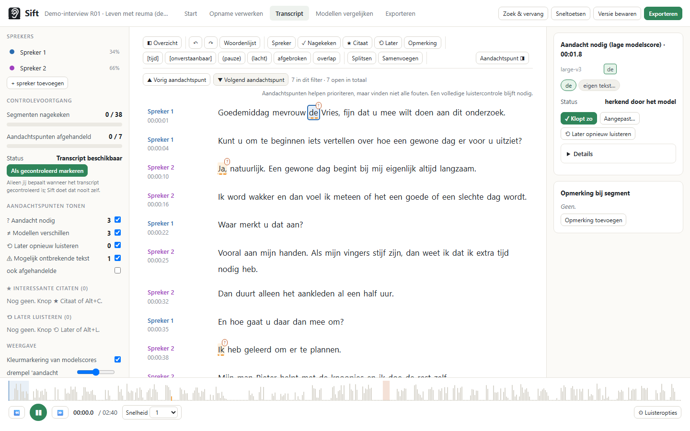
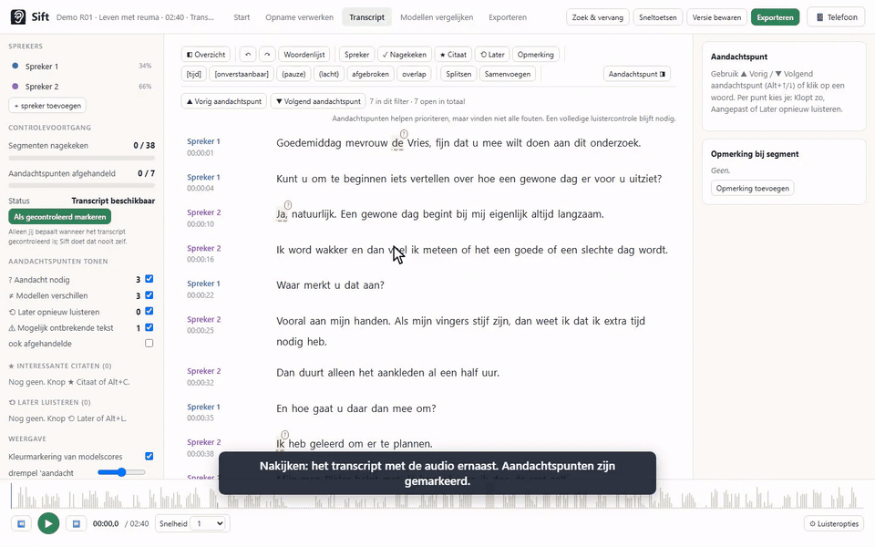
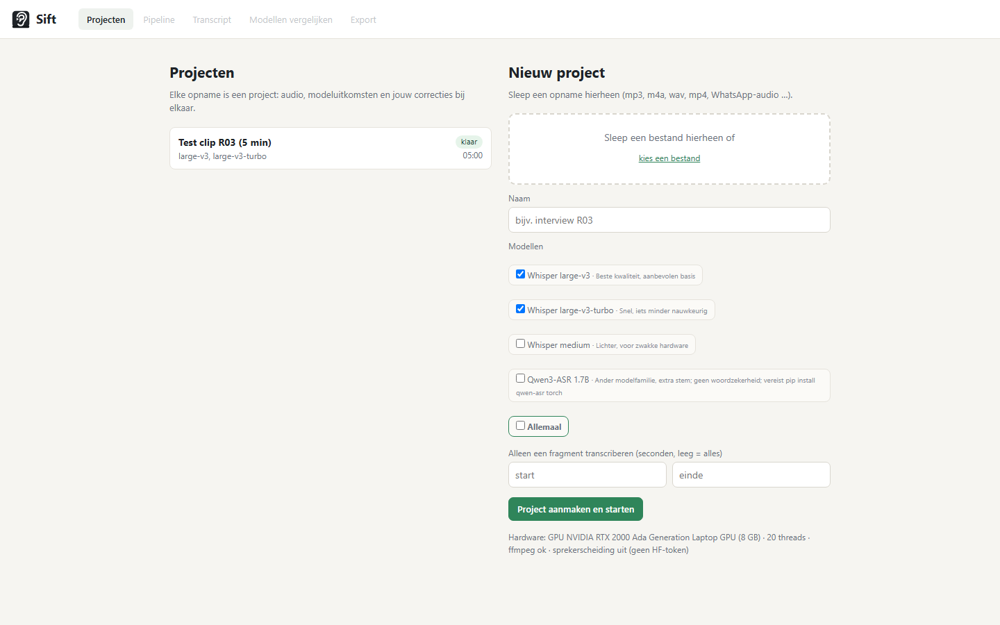
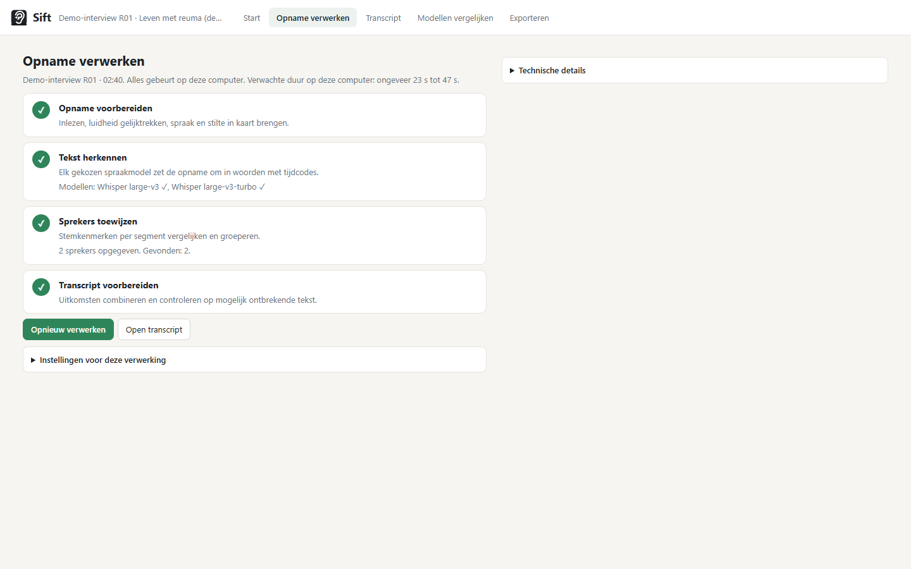
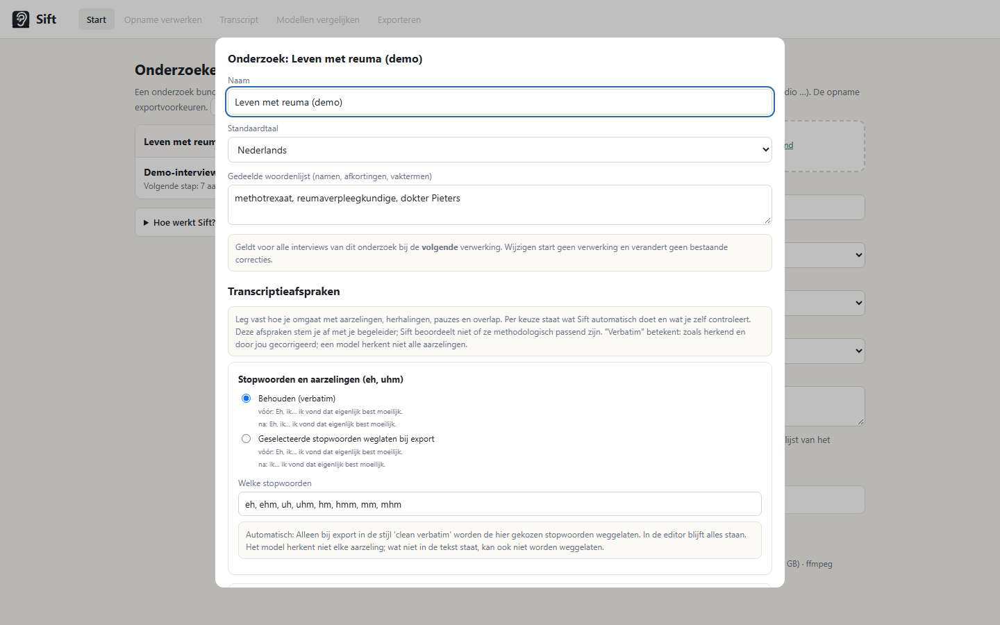
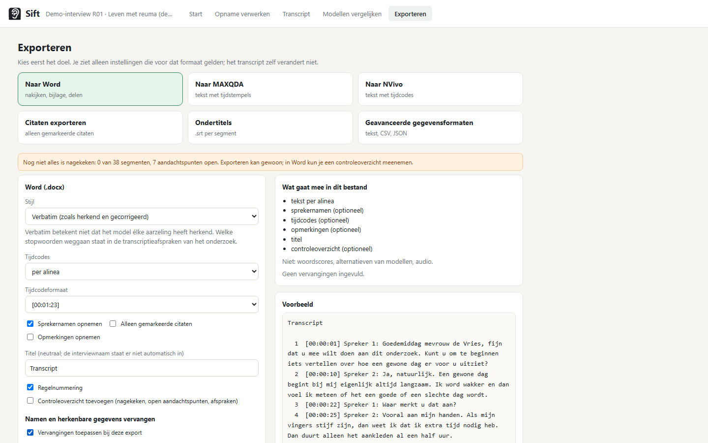

🇬🇧 English · 🇳🇱 [Nederlands](README.nl.md)

<p align="center"></p>

# Sift

**From interview recording to a reviewed transcript, on your own computer, with help on the passages that need attention.**

Sift is for students and researchers who conduct interviews (health sciences, medical sciences, other qualitative
research) and need a carefully reviewed transcript that follows the conventions of their study. You don't need to know
anything about Python, models or audio engineering. The recording never leaves your computer.

The app's interface is currently in Dutch. Where this README refers to buttons and labels, the Dutch label is quoted
with an English gloss in parentheses, e.g. "Opname verwerken" (process recording).

What Sift does:

1. You pick a recording and say which language is spoken and by how many people.
2. Sift turns the recording into text with timecodes, assigns speakers and marks what needs attention.
3. You review the transcript with the audio beside it: click a word and you hear the fragment; Sift guides you through the points of attention.
4. You export to Word, MAXQDA, NVivo, a list of quotes or a data format, optionally with names replaced.



## Installing without Python (Windows) and the Android app

- **Windows installer**: `Sift-Setup-<version>.exe` on the [Releases page](https://github.com/PiMo131/sift/releases). On first start it installs the right components itself (GPU or CPU) and downloads Whisper on the first transcription. Also available as an offline bundle. Explanation, SmartScreen, requirements and disk space: [docs/INSTALL.md](docs/INSTALL.md) (Dutch).

  Sift opens in its own window (Microsoft Edge WebView2, present on Windows 11 and with Edge on Windows 10; the installer fetches it if missing). Closing the window keeps Sift running in the system tray so a transcription continues; the tray icon offers *Sift tonen* (show), *Openen in browser*, the project and log folders and *Afsluiten* (quit), which stops the server. Starting Sift again brings the existing window to the front. `Sift.exe --browser` gives the old behaviour (default browser, no window).
- **Android app**: `Sift-<version>.apk` on the same page. Scan the QR code from Sift, send recordings (including WhatsApp audio) to your PC and review on your phone: [docs/ANDROID.md](docs/ANDROID.md) (Dutch).

Both are built automatically by GitHub Actions on a version tag (`v0.1.0`). The installer is not digitally signed, so Windows asks once for "Toch uitvoeren" (run anyway).

## Starting from source

Without the installer you start Sift from source (Windows, Linux, macOS):

1. Install [Python 3.10 or newer](https://www.python.org/downloads/) and [ffmpeg](https://ffmpeg.org) (Windows: `winget install Gyan.FFmpeg`).
2. Download this repository (green *Code → Download ZIP* button, or `git clone https://github.com/PiMo131/sift.git`) and unpack it.
3. Double-click `start.ps1` (Windows) or run `./start.sh` (Linux/macOS). The first time, the components are installed; that takes a few minutes. On Windows, `start-app.ps1` starts the same thing in Sift's own window (needs the .NET 8 SDK).
4. Your browser opens `http://127.0.0.1:8765`.

On the first processing run Sift downloads a speech model once (1.6 to 3.1 GB; you see the progress). After that
everything works without internet. Requirements, disk space and model downloads are in [docs/INSTALL.md](docs/INSTALL.md) (Dutch).

## Try it with the fictional demo interview

`demo/` contains an entirely made-up 2.5-minute interview about daily life with rheumatism, spoken with synthetic
voices (`demo/demo_interview.m4a`, script with timecodes in `demo/script.md`). It deliberately contains a quiet passage,
a four-second silence and a sentence so quiet and fast that the speech models skip it.

1. Start Sift, click "+ Nieuw onderzoek" (new study) and give it a name.
2. Under "Nieuw interview" (new interview), choose the file `demo/demo_interview.m4a`, language Dutch, 2 speakers, and click "Transcript maken" (create transcript).
3. After half a minute to a few minutes (depending on your computer) the transcript is ready. Use "Volgend aandachtspunt" (next point of attention) to go through the passages that need attention; at about 1:29 you'll find "Mogelijk ontbrekende tekst — luister terug" (possibly missing text — listen back): that is the sentence from the script that was left out.



A 2.5-minute demo video (home page, processing, reviewing, comparing models, exporting, phone) is in [docs/demo.mp4](docs/demo.mp4); it was made with `demo/record_demo.py`.

All results in this README and in `docs/` were produced with this demo interview; the screenshots were generated with
`docs/screenshots.py`. No real interview material was used.

## The full flow

### 1. Creating a study and an interview

A **study** ("onderzoek") groups interviews with a shared word list (names, abbreviations, technical terms),
transcription conventions and export preferences. An **interview** is one recording with its own transcript, speakers,
comments, points of attention, versions and review status. For each interview you see the status and the next useful step.

For a new interview you provide: the recording, a name, the spoken language, the number of speakers (or "weet ik niet",
don't know: Sift then estimates it from voice characteristics; check it afterwards) and optionally names and technical
terms. Sift picks a suitable configuration for your computer by itself; specialist settings are under "Geavanceerd"
(advanced). With "Probeer eerst twee minuten" (try two minutes first) you process a fragment first; afterwards you can
do the whole recording with one click.



### 2. Processing the recording

Processing shows in plain language what is happening: preparing the recording, recognising text (per model), assigning
speakers, preparing the transcript. A model download is shown separately, with size and progress. As soon as there is
enough data, you see an estimate of the remaining time with a margin. On an error you get concrete next steps; the
technical message and the log are under "Technische details" (technical details). Interrupting keeps what is already
finished; resuming continues where it left off.



### 3. Reviewing

The transcript is shown as plain, calm text. Points of attention are marked with a symbol (so they work without colour
too): `?` *attention needed* (low model score), `≠` *models give different words*, `⟲` *listen again later*,
`⚠` *possibly missing text*. With "Vorig / Volgend aandachtspunt" (previous / next point of attention, Alt+↑/↓) you walk
through them and choose for each one: **"Klopt zo"** (correct as is), **"Aangepast"** (adjusted) or **"Later opnieuw
luisteren"** (listen again later). Handled points don't come back, unless you change the word later after all. Filters
determine which kinds you see.

"Interessant citaat" (interesting quote, Alt+C) and "Later opnieuw luisteren" (listen again later, Alt+L) are separate
markers with their own lists. Existing highlights from older projects were carried over during migration as
"Interessant citaat".

Click a word to hear the fragment (can be switched off under "Luisteropties", listening options), simply type over the
text, pick an alternative from another model, switch the speaker, split or merge, and undo everything with Ctrl+Z.
Everything is saved automatically; the status at the bottom says honestly "wijzigingen aanwezig" (unsaved changes),
"bezig met opslaan" (saving), "opgeslagen" (saved) or "opslaan mislukt" (saving failed, with a button to retry). Ctrl+S
saves immediately.

Points of attention help you prioritise, but they do not find every error. A full listening check remains the norm; the
progress (segments reviewed, points of attention handled) is based on your review, not on model confidence.
"Gecontroleerd" (reviewed) is a status that only you set.

| Key | Action |
|---|---|
| Ctrl+Space | Play / pause (skips back slightly when resuming) |
| Ctrl+← / Ctrl+→ | 3 seconds back / forward |
| Alt+↓ / Alt+↑ (J / K outside the text) | Next / previous point of attention |
| Alt+K · Alt+L · Alt+C | Correct as is · Listen again later · Interesting quote |
| Alt+S | Switch speaker |
| Ctrl+Enter | Segment reviewed, on to the next |
| Ctrl+S · Ctrl+Z · Ctrl+Y | Save · undo · redo |
| Ctrl+U · Ctrl+F | Insert [onverstaanbaar hh:mm:ss] (unintelligible) · find and replace |
| Enter · Backspace at the start | Split · merge |
| Tab / Shift+Tab | Normal focus navigation across buttons and fields |

### 4. Transcription conventions

Per study you record how you deal with filler words, repetitions, broken-off sentences, pauses, laughter,
unintelligible passages and overlap, with a before/after example for each choice. Sift is precise about what happens
automatically (only: omitting selected filler words in a *clean verbatim* export) and what you do yourself (the buttons
in the toolbar insert the chosen notation). *Verbatim* means: as recognised and corrected by you; a model does not
recognise every hesitation. The timecode format `#hh:mm:ss-t#` is only a notation, not full support for the Dresing &
Pehl protocol. The conventions can be exported as text to agree on with your supervisor; Sift does not judge whether
they are methodologically appropriate.



### 5. Exporting

You start with the goal: **"Naar Word"** (to Word), **"Naar MAXQDA"** (to MAXQDA), **"Naar NVivo"** (to NVivo),
**"Citaten exporteren"** (export quotes), **"Ondertitels"** (subtitles) or **"Geavanceerde gegevensformaten"** (advanced
data formats: text, CSV per segment, CSV per word, "Transcriptgegevens (JSON)", transcript data as JSON). For each format
you only see the settings that apply to it, what ends up in the file, and a preview. Settings are kept when you switch.

"Namen en herkenbare gegevens vervangen" (replace names and identifying details) is a table (text to replace →
replacement) that applies to transcript text, speaker names, comments, alternative words, title and file name; all
replacements happen in one pass, with word boundaries and case preservation. This is pseudonymisation, not guaranteed
anonymisation: places, organisations and descriptions can still make someone identifiable. The transcript and the
recording are not changed.

Word gets line numbering, a neutral title and optionally a review overview (reviewed, open points of attention,
conventions). The MAXQDA and NVivo files follow aTrain's text-with-timestamps layout; they have **not been tested in
MAXQDA or NVivo themselves** and are labelled as such in the interface.



### 6. Versions and backup

"Versie bewaren" (keep version) saves the current text, including what you are still typing. Under "Exporteren →
Versies" (export → versions) you see date, name and a preview, and you can restore; before restoring, the current state
is saved automatically. A **full backup** (zip) contains the original recording, transcript, speakers, comments,
versions, model output, settings and the study. So it is *not* a pseudonymised export. Restoring always creates a new
interview and never overwrites anything.

## From your phone

Record or send an interview with your phone, without a cable or cloud:

1. In Sift, click **"📱 Telefoon"** (phone, top right) and switch on **"Bereikbaar op het netwerk"** (reachable on the network), or start Sift with `.\start.ps1 --lan`. The same QR code and code are also on the home page, under "Nieuw interview".
2. Scan the QR code with your phone's camera (same Wi-Fi, no guest network). The 4-digit code is included; otherwise type it in.
3. On the phone: **"Tik om een opname te kiezen"** (tap to choose a recording), or record directly with **"Opname starten"** (start recording). Tick "direct transcriberen" (transcribe immediately) if processing may start right away.
4. The recording appears on the computer as an interview (on the phone you can link it to a study right away; otherwise it goes under "Zonder onderzoek", without study). Via **"Open in Sift"** you can also follow the progress and view and review the transcript on your phone (toolbar with "Volgend aandachtspunt"; the "Overzicht" (overview) and "Aandachtspunt" (point of attention) panels fold in and out with the buttons in the toolbar).

Requests from other devices are only admitted with the code (5 wrong attempts = wait a minute); **"Nieuwe code"** (new code) generates another one. Windows Firewall may ask for permission on the first connection: choose *Allow access* for private networks. Recording in the browser only works over https or localhost; via the Wi-Fi address Android and iOS block the microphone, so choose a recording from your recorder app instead (or use the Sift app for Android, see [docs/ANDROID.md](docs/ANDROID.md) (Dutch)). The page `http://<ip>:8765/drop` can be added to the home screen as a PWA.

## What stays local and what needs internet

- Recordings, transcripts, comments, exports and backups stay on your computer (folder `projects/`, configurable with `SIFT_PROJECTS`). Nothing is uploaded; there is no account and no analytics.
- Internet is only needed for the one-time download of speech models from Hugging Face (and, when installing from source, for the Python components). The interface shows downloads.
- Preferably don't put the project folder in a synchronised folder (OneDrive): synchronisation sometimes briefly locks files. Sift then retries the write and reports honestly if it fails.

## Support and known limitations

- Model scores are hints, not a measured probability that a word is correct. Points of attention do not find every error; a full listening check remains necessary.
- The *possibly missing text* check uses voice activity detection and differences between models. It misses passages that *all* models *and* the voice activity detection skip, and can trigger on laughter, coughing or background noise. Dismissing takes one click.
- Speaker separation works well with two clearly different voices; with more speakers or similar voices, corrections are needed. "Weet ik niet" (don't know) is an estimate.
- Pseudonymisation only replaces what you put in the table. Context can keep someone identifiable.
- MAXQDA and NVivo import has not been tested in those programs.
- The Windows installer is not digitally signed (SmartScreen warning on first start); starting from source requires Python and ffmpeg.
- Tested on Windows 11 with an NVIDIA RTX 2000 Ada (8 GB) and on the CPU; Linux/macOS only via `start.sh`, not extensively tested.

Questions or problems: open an issue on GitHub with the text under "Technische details" (without recording or transcript).
An overview of the checks performed is in [docs/VERIFICATIE.md](docs/VERIFICATIE.md) (Dutch), the status per
component in [docs/IMPLEMENTATIE.md](docs/IMPLEMENTATIE.md) (Dutch).

---

## For developers

### Installing from source and starting

```powershell
git clone https://github.com/PiMo131/sift.git
cd sift
.\start.ps1                       # creates .venv, installs requirements.txt, starts on http://127.0.0.1:8765
.\.venv\Scripts\python -m sift --no-browser --port 8765
```

Linux/macOS: `./start.sh`. Environment variables: `SIFT_PROJECTS` (project folder), `SIFT_FFMPEG` (path to ffmpeg).
GPU: an NVIDIA card with a recent driver; cuBLAS/cuDNN come via pip, CUDA does not need to be installed separately.

### Tests

```powershell
.\.venv\Scripts\python -m pip install pytest playwright && .\.venv\Scripts\python -m playwright install chromium
.\.venv\Scripts\python -m pytest tests            # backend (export, pseudonymisation, migration, backup, API) + browser tests
.\.venv\Scripts\python tests\walkthrough_demo.py  # the twelve verification steps with real transcription of the demo interview
.\.venv\Scripts\python demo\generate_demo.py      # regenerate the demo audio (edge-tts, needs internet)
```

### Architecture

Backend: FastAPI (`sift/server.py`) with faster-whisper (CTranslate2) in subprocesses (`sift/engines/`), SpeechBrain
ECAPA embeddings with Ward clustering for speakers (`sift/diarize.py`), combining model outputs (`sift/consensus.py`),
missing-text check with Silero VAD (`sift/gaps.py`), exports with a contract per format (`sift/export.py`,
`sift/pseudonym.py`), backup (`sift/backup.py`), studies (`sift/studies.py`), transcription conventions
(`sift/conventions.py`), review status (`sift/review.py`) and versioned migrations (`sift/migrate.py`). Frontend:
vanilla JS without a build step (`sift/static/app.js`, `process.js`, `editor.js`, `export.js`).

```
projects/<interview>/
  project.json          settings, status, review status, study_id                 (schema_version 2)
  transcript.json       the editable transcript: segments, words, markers, gaps    (schema_version 2)
  versions/             versions (+ .meta.json with name and date)
  runs/<model>.json     raw output per model (start, end, word, p)
  work/                 audio_16k.wav, audio_norm.wav, play.m4a, peaks.json, vad.json, diarization.json
projects/_studies/<id>.json   study: name, word list, conventions, export preferences
```

Old projects (without `schema_version`) are migrated in memory when loaded and only written on the next save;
`sift/migrate.py` also contains the reverse step. The per-model word format is the same everywhere, so a new engine is a
one-file adapter.

### Models and processing

| Model | Quality | GPU (RTX 2000 Ada) | CPU (i7-13700H, int8) |
|---|---|---|---|
| Whisper large-v3 | best | ± 7–11× realtime | ± 1.5× realtime |
| Whisper large-v3-turbo | good | ± 25–38× realtime | ± 2.5× realtime |
| Whisper medium | fair | ± 12× | ± 3× |
| Qwen3-ASR 1.7B (optional) | variable | ± 5× | too slow |

Speeds measured on 29–30 October 2026 with faster-whisper 1.2.1 on the hardware mentioned (see
`benchmark/BENCHMARK.md`, Dutch). Audio is first normalised (highpass, compressor, loudnorm −16 LUFS); in a limited
trial that reduced the number of uncertain words by a quarter. Multiple models are aligned per word on time (with
correction for shifted word timings); strategies: consensus, highest score, base model + alternatives. Models run one
after another: two models at once on a single 8 GB GPU turned out ten to thirty times slower.

The benchmark in `benchmark/BENCHMARK.md` is a **limited trial without a manual reference transcript**: the figures are
average model scores and counts of uncertain words on one recording, not measured word error rates. Statements about
transcription quality require an independently checked reference transcript.

### Licences of the components

| Component | Licence |
|---|---|
| Sift | MIT |
| Whisper models (OpenAI) via faster-whisper / CTranslate2 | MIT |
| SpeechBrain ECAPA speaker embeddings | Apache 2.0 |
| Qwen3-ASR (optional) | Apache 2.0 |
| FastAPI, uvicorn, python-docx, soundfile, numpy, scipy | MIT / BSD |
| ffmpeg (external program) | LGPL/GPL |
| edge-tts (only for generating the demo) | GPL-3.0; not shipped with Sift |

### Acknowledgements and sources

Ideas taken from noScribe (speaker assignment, pause display, subprocess architecture), aTrain (MAXQDA export,
faster-whisper settings), f4 (rewind on resume, text building blocks), Sonix (confidence marking as a toggle),
MacWhisper (find and replace, export presets) and Amberscript (pseudonymisation, Dresing & Pehl notation).
The design research is in `ONDERZOEK.md` (Dutch).

Licence: MIT.
